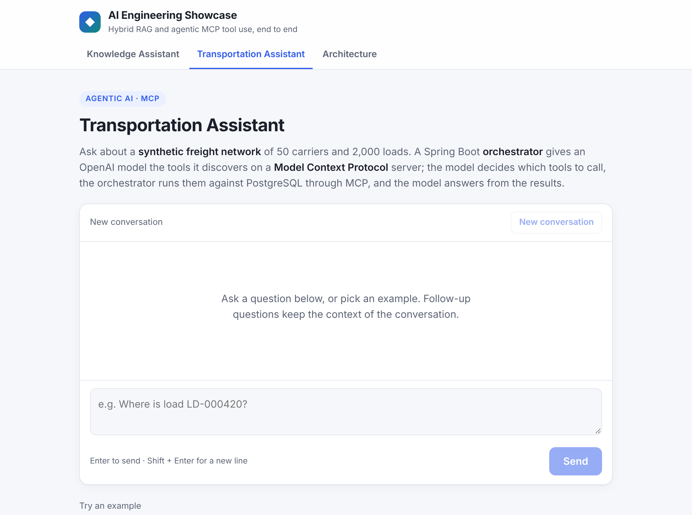
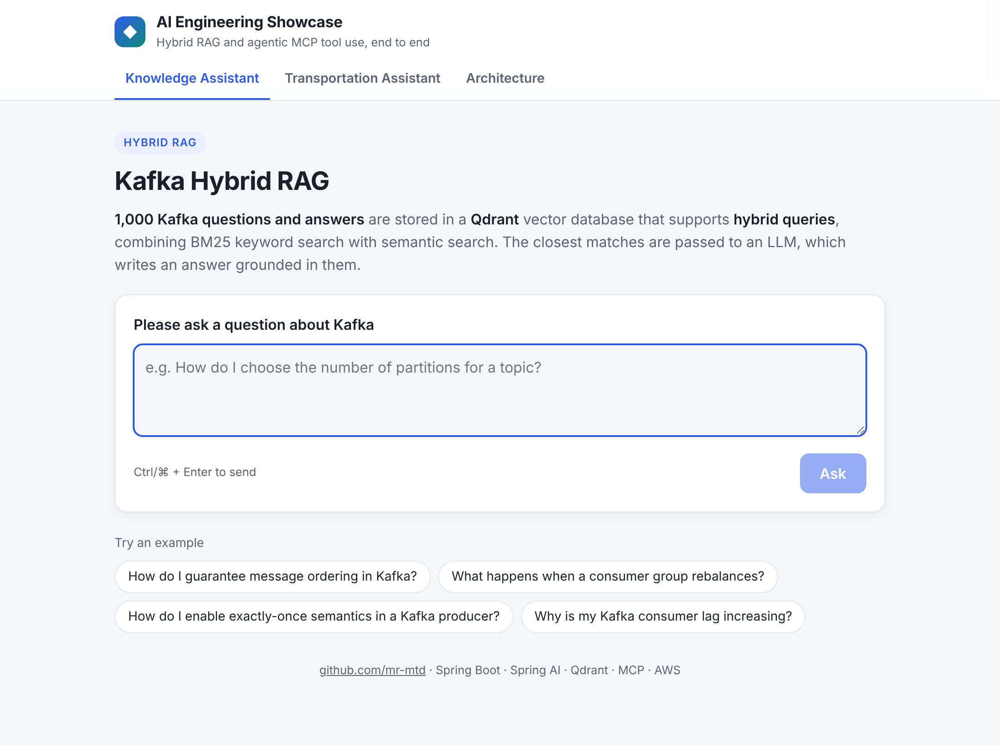
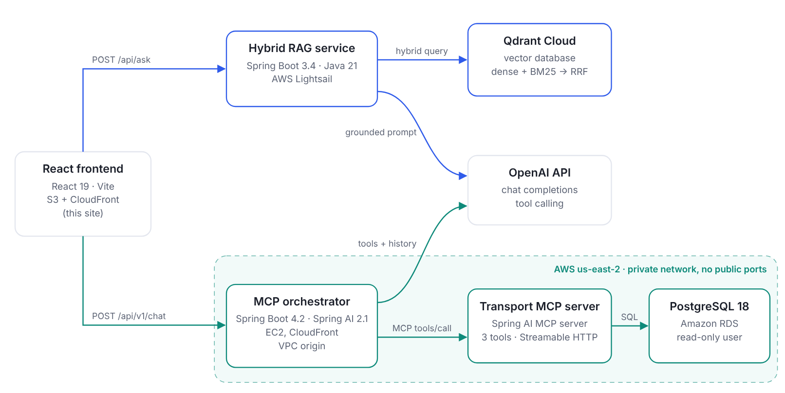
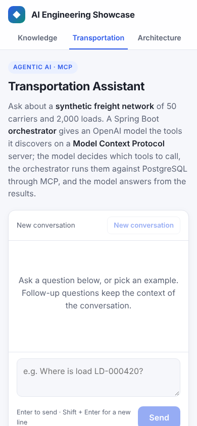
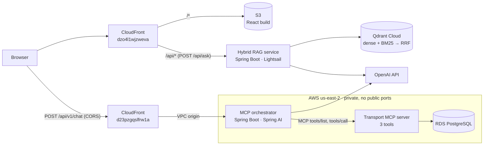

# AI Engineering Showcase – React Frontend
[](https://github.com/mr-mtd/rag-agentic-ai-showcase/actions/workflows/build.yml)
[](https://github.com/mr-mtd/rag-agentic-ai-showcase/actions/workflows/deploy.yml)


[](LICENSE)

**Live demo: https://dzo4l1wjzweva.cloudfront.net/**

One React app in front of two independent AI backends:

| Tab | Backend | What it shows |
| --- | --- | --- |
| **Knowledge Assistant** | [springboot_hybrid_RAG](https://github.com/mr-mtd/springboot_hybrid_RAG) | Retrieval-augmented generation over 1,000 Kafka Q&As: hybrid BM25 + dense search in Qdrant, fused with Reciprocal Rank Fusion, answered by OpenAI with cited sources. |
| **Transportation Assistant** | [springboot_mcp_orchestrator](https://github.com/mr-mtd/springboot_mcp_orchestrator) → [springboot_MCP_server](https://github.com/mr-mtd/springboot_MCP_server) | Agentic AI: a multi-turn chat where an OpenAI model calls tools it discovers on a Model Context Protocol server (load status, carrier details, delayed shipments over PostgreSQL). Every answer has a collapsible panel with the real tool calls, arguments, outcomes, durations, model and token usage. |
| **Architecture** | none | Diagram, key concepts, technology stack, AWS deployment and links to all four repositories. |



<details>
<summary>More screenshots</summary>





</details>

## Architecture



- **Knowledge Assistant** calls `/api/ask` on its own origin. The site's CloudFront distribution forwards `/api/*` to the RAG service on Lightsail.
- **Transportation Assistant** calls `https://d23pzgqslfrw1a.cloudfront.net/api/v1/chat`, the orchestrator's own distribution, which reaches the EC2 instance through a CloudFront VPC origin. The orchestrator's CORS allowlist includes this site's origin. The MCP server and database have no public endpoint, and the browser never learns their addresses.
- **No secrets in the frontend.** OpenAI keys live on the backends; every `VITE_*` value is a public URL or a number.

## Run it

Requires **Node.js 20.19+ or 22.12+** (Vite 8).

```bash
npm install
npm run dev
```

Open http://localhost:5173. The dev server proxies `/api/v1` to the hosted orchestrator and `/api` to the hosted RAG service, so both tabs work with no backend running locally. The proxy drops the `Origin` header, so the backends' CORS allowlists (which list the deployed site, not localhost) don't block local development.

## Configuration

All values are read at build time and are public. Copy `.env.example` to `.env` to set them locally, then restart the dev server.

| Variable | Used by | Default | Purpose |
| --- | --- | --- | --- |
| `VITE_API_TARGET` | `dev`, `preview` | the Lightsail RAG service | Where the Vite server proxies `/api` (Knowledge Assistant). e.g. `http://localhost:8080` |
| `VITE_ORCHESTRATOR_TARGET` | `dev`, `preview` | `https://d23pzgqslfrw1a.cloudfront.net` | Where the Vite server proxies `/api/v1` (Transportation Assistant). e.g. `http://localhost:8081` |
| `VITE_API_BASE_URL` | `build` | empty | RAG service URL. Empty means same origin (`/api/ask`), which is what production uses. |
| `VITE_ORCHESTRATOR_BASE_URL` | `build` | empty | Orchestrator URL. Production sets `https://d23pzgqslfrw1a.cloudfront.net` in `deploy.yml`. Empty means same origin. |
| `VITE_API_TIMEOUT_MS` | app | `60000` | Client timeout for RAG requests. |
| `VITE_ORCHESTRATOR_TIMEOUT_MS` | app | `60000` | Client timeout for chat requests (matches the 60 s CloudFront origin timeout). |

If the frontend moves to a new domain, add that origin to the orchestrator's `CORS_ALLOWED_ORIGINS` repository variable (and the RAG service's, if it is called cross-origin).

## API contracts

### Knowledge Assistant: `POST /api/ask`

```json
{ "question": "How do I guarantee message ordering in Kafka?" }
```

```json
{
  "answer": "Kafka only guarantees ordering within a partition [Source 1] ...",
  "sources": [{ "id": "101", "question": "Does Kafka guarantee message order across partitions?" }]
}
```

### Transportation Assistant: `POST /api/v1/chat`

```json
{ "message": "Where is load 420?", "conversationId": "optional, from the previous reply" }
```

```json
{
  "conversationId": "7a35d7b7-936b-41f9-addc-22ccb431565b",
  "answer": "LD-000420 is in transit with Swift Freight, 3.4 hours late.",
  "model": "gpt-5-mini",
  "toolCalls": [
    { "tool": "getLoadStatus", "arguments": "{\"loadNumber\":\"420\"}", "outcome": "success", "durationMs": 19 }
  ],
  "usage": { "promptTokens": 250, "completionTokens": 50, "totalTokens": 300 },
  "durationMs": 1903
}
```

The app sends the returned `conversationId` with every follow-up and drops it on **New conversation**. The server keeps history in memory for an hour, so it is lost if the orchestrator restarts. Errors are RFC 9457 problem details: `400` invalid message, `502` model failure, `503` MCP server unreachable; each gets its own message in the UI with a **Retry** button.

The technical details panel shows only what the API returns, plus two values the browser measures itself: round-trip latency and the `X-Request-Id` response header (useful for finding the request in the orchestrator's logs). Missing values are shown as "Not reported". There is no streaming, so the UI shows a single loading state instead of step-by-step progress.

## Project layout

```
src/
├── App.jsx                      App shell: header, tabs (URL hash), footer
├── config.js                    Build-time configuration (base URLs, timeouts)
├── api/
│   ├── http.js                  Shared JSON POST with timeout, HttpError, TimeoutError
│   ├── ragClient.js             POST /api/ask
│   └── orchestratorClient.js    POST /api/v1/chat, error messages
├── components/                  Shared UI: ExamplePrompts, LoadingStatus, ErrorAlert, Markdown
├── features/
│   ├── knowledge/               KnowledgeAssistant (the original RAG page)
│   ├── transportation/          TransportationAssistant, ExecutionDetails, example prompts
│   └── architecture/            Architecture page and SVG diagram
└── index.css                    Styles, light and dark themes
```

The two integrations share nothing but `http.js` and the presentational components, so either backend can change its contract without touching the other.

## Tests

```bash
npm test             # run once
npm run test:watch   # re-run on save
```

Vitest with React Testing Library in jsdom; the backends are mocked, so tests need no network.

- `api/*.test.js`: request shape, base URLs, conversation id handling, timeouts, aborts, problem-detail errors.
- `features/knowledge`: the original RAG tests (submit, shortcuts, examples, loading, errors).
- `features/transportation`: multi-turn conversations, new conversation, Markdown tables and lists, raw HTML not rendered, duplicate-submit guard, every error type with retry, and the technical details panel (failed vs successful tools, tokens, latency, "Not reported").
- `App.test.jsx`: tabs, URL hash, keyboard navigation, repository links.

## Continuous integration and deployment

`.github/workflows/build.yml` runs tests and a production build on pushes and pull requests to `main` and `feature/dev`.

`.github/workflows/deploy.yml` runs on every push to `main`: tests, build (with `VITE_ORCHESTRATOR_BASE_URL` set to the orchestrator's distribution), sync to S3 (fingerprinted assets cached for a year, `index.html` always revalidated) and a CloudFront invalidation.

```
browser ──► CloudFront (dzo4l1wjzweva) ──┬─ /*      ──► S3 bucket (private, Origin Access Control)
                                          └─ /api/*  ──► Lightsail RAG service
        ──► CloudFront (d23pzgqslfrw1a) ──── /api/v1/chat ──► VPC origin ──► orchestrator on EC2
```

### AWS access without stored keys

The workflow authenticates with **GitHub OIDC** instead of long-lived access keys:

1. GitHub issues the job a short-lived signed token (`permissions: id-token: write`).
2. `aws-actions/configure-aws-credentials` exchanges it with AWS STS for temporary credentials of the IAM role `github-actions-hybrid-rag-frontend-deploy`.
3. The role's **trust policy** only accepts tokens whose `aud` is `sts.amazonaws.com` and whose `sub` is `repo:mr-mtd/rag-agentic-ai-showcase:ref:refs/heads/main` or its ID-qualified form `repo:mr-mtd@49491060/rag-agentic-ai-showcase@1473934309:ref:refs/heads/main` (which this repo actually sends), so forks, pull requests and other branches can't assume it. **Renaming the repository changes the `sub`, so update the trust policy if the repo is renamed again** (it was renamed from `react_hybrid_RAG_frontend` on 2026-11-27).
4. The role's **permissions policy** allows only `s3:ListBucket`, `s3:PutObject` and `s3:DeleteObject` on the site bucket, and `cloudfront:CreateInvalidation` on this one distribution.

## Security notes and known limits

- Authentication is deferred for this MVP. Both chat endpoints are public and spend OpenAI tokens, so keep a monthly budget limit in the OpenAI dashboard. The cheapest next step if the endpoints get abused is a rate-based AWS WAF rule on the two distributions.
- Model answers are rendered with `react-markdown`, which does not render raw HTML, so an answer can't inject markup or scripts.
- The orchestrator shares one MCP session (and rate-limit budget) across all users.

## License

[MIT](LICENSE)
